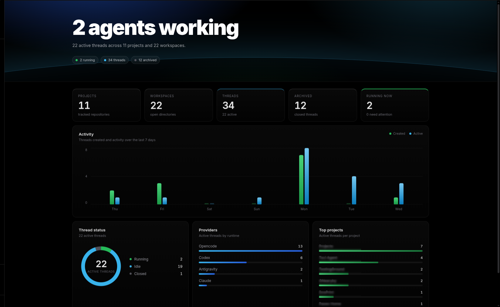

<h1 align="center">🏠 paseo-home-plugin 🏠</h1>

<p align="center">
    
</p>

> [!NOTE]
>
> **paseo-home-plugin** adds a home dashboard to Paseo. It summarizes your projects, workspaces, and agent threads, with a live status breakdown and activity from the last seven days. The dashboard reads counts from Paseo's local API and does not display thread titles.

## 🌟 Features

- **Workspace overview** – counts for projects, workspaces, threads, archived threads, and running agents
- **Live thread status** – running, idle, initializing, error, and closed thread counts, plus agents that need attention
- **Recent activity** – a seven-day chart of threads created and threads active
- **Provider and project breakdowns** – see active thread counts by runtime and the busiest projects
- **Automatic refresh** – updates every five seconds while the dashboard is visible
- **Theme-aware colors** – surfaces, text, selected items, and status indicators follow Paseo's active theme
- **Counts only** – shows aggregate data without thread titles

## 🚦 Thread statuses

| Status          | Meaning                                      |
| :-------------- | :------------------------------------------- |
| `running`       | An agent is currently working                |
| `idle`          | An agent is waiting                           |
| `initializing`  | An agent is starting                          |
| `error`         | An agent has encountered an error             |
| `closed`        | A thread is closed                            |

Archived threads are counted separately and excluded from the status, provider, and project breakdowns.

## 📷 Screenshots

| Home dashboard |
| :-------------: |
|  |

## 💻 Installation

Requires [Paseo](https://paseo.sh) desktop `0.11.4` or newer.

###### From a local checkout

```bash
bun install
bun run typecheck
paseo plugin add ./
```

## 🛠️ Development

The plugin uses TypeScript, React, TanStack Query, and Zod. The shared Zod schema in `shared/home.ts` defines the `home.stats` RPC contract used by both the server handler and dashboard.

Available scripts:

```bash
bun run typecheck
bun run lint
bun run format
```

## 💻 Contributing

Contributions are welcome. Please keep the shared RPC schema and its server response aligned when changing dashboard data.

## 🙋 Issues

For bugs or questions, open an issue in this project's repository.

## 👤 Author

<table>
  <tbody>
    <tr>
      <td align="center" valign="top" width="14.28%"><a href="https://github.com/ArnavK-09"></a><br /><a href="https://github.com/ArnavK-09"><h4><b>Arnav K</b></h4></a></td>
    </tr>
  </tbody>
</table>
